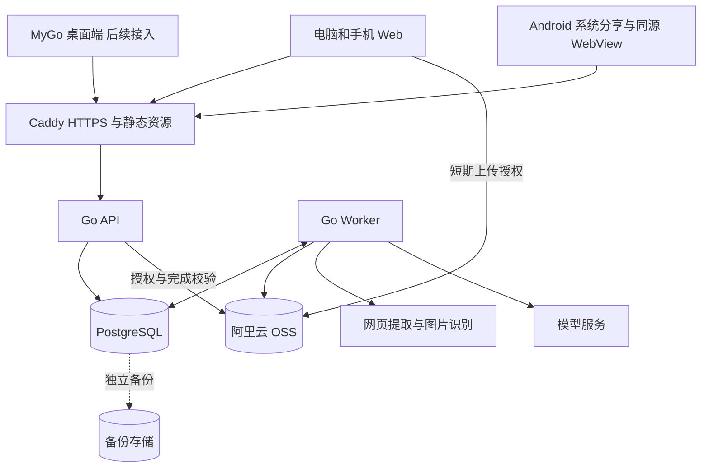

# Spark 在线版系统架构

更新于 2026-11-16。目标是先交付可恢复、可诊断的邀请内测服务，再按实际负载扩展。产品行为以 [产品需求](PRODUCT.md) 为准。

## 当前实现与演进目标

MyGo 程序继续通过 `internal/entries/service.go` 操作本地 SQLite，图片存于库内，整理通过进程内 goroutine 执行。在线版首批 `server/` 与 `apps/web/` 已实现用户归属、项目、受限富文本、文字/网址收藏及网络接口，在 OrbStack 中运行；OSS、正文及 OCR 提取、模型与持久任务仍待实现。当前能力与验证状态统一见 [HANDOFF](HANDOFF.md) 和 [ROADMAP](ROADMAP.md)，下文技术选型与完整数据流包含后续目标。

初期采用模块化单体，同一后端工程构建 API 与 Worker 两个进程。跨模块调用显式传递用户和业务输入，事务在用例层组织。提取器、模型和对象存储通过实际需要替换的接口接入。



## 技术选型

| 层次 | 采用方向 | 实施说明 |
| --- | --- | --- |
| Web | React、TypeScript、Vite、React Router、TanStack Query | 静态构建，响应式界面 |
| 编辑器 | Tiptap 开源核心 | 只启用首发内容协议允许的节点与标记 |
| 后端 | Go、Gin | REST，版本化接口和统一错误结构 |
| 数据 | PostgreSQL、pgx、sqlc、版本化 SQL 迁移 | 在目标环境验证并锁定兼容版本 |
| 任务 | River 与 PostgreSQL | 收藏写入和任务入队同事务 |
| 附件 | 阿里云 OSS 私有桶 | 短期授权、服务端确认、孤立上传回收 |
| 桌面 | MyGo Native UI、SQLite | 本地副本、待同步操作和客户端适配 |
| Android | Java、系统 WebView、私有 SQLite | 网页承担在线业务和导航，原生处理系统分享、离线草稿及提交恢复 |
| 部署 | Docker Compose、Caddy | API、Worker、数据库分别运行 |
| 诊断 | Go 结构化日志、云监控 | 请求 ID、任务 ID、错误统计、外部探测；按需要接入 OpenTelemetry |

模型与 OCR 服务商在小样本评测后锁定。通义千问为候选，核对数据存储位置、实际推理部署范围、用量与并发约束。供应商密钥由服务器秘密配置提供，浏览器取得限定用途的授权。

## 代码组织

目标目录按阶段迁移，入口搬迁与功能改动分别验收。

```text
apps/web/                 Web 应用与页面测试
apps/desktop/             MyGo 入口、视图、本地存储与同步
apps/android/             原生系统分享、本机草稿、在线工作区宿主
server/cmd/api/           HTTP 入口
server/cmd/worker/        后台任务入口
server/internal/         identity、collections、projects、media、organization、search
server/db/               迁移、查询与 sqlc 产物
contracts/               OpenAPI、内容 JSON Schema、同步样例
deploy/                  容器、发布、备份与恢复配置
docs/                    产品、架构与交付计划
```

首期独立后端 Go module，保留现有桌面运行入口。复用经过测试的规则与 URL 校验逻辑时明确归属，避免长期维护两份业务实现。生成的 Go 和 TypeScript 客户端由接口契约驱动。

## 核心数据与约束

| 数据 | 关键字段与约束 |
| --- | --- |
| 用户与会话 | 规范化邮箱唯一，密码哈希，会话到期与撤销，管理员角色 |
| 邀请批次与邀请码 | 代码摘要唯一、批次、有效期、限额、兑换记录；账号创建和兑换原子完成 |
| 项目 | `user_id`、名称、描述、关注点、状态、版本 |
| 收藏 | `user_id`、UUID、原始文档、用途、原始 URL、手动标题、内容版本、资源版本、已读时间、删除时间 |
| 收藏版本 | 用户内容和格式快照，版本号，修改时间 |
| 附件 | 所属用户、不可预测对象键、校验和、实际大小、类型、上传状态、关联收藏 |
| 提取结果 | 来源种类、内容版本、正文或 OCR、提取时间、失败原因、提取器版本 |
| 整理结果 | 输入版本、模型、提示版本、生成标题与摘要、阶段状态、用量 |
| 标签与关联 | 用户内标签唯一、层级关系；收藏关联记录来源与用户确认或排除状态 |
| 项目关联 | 收藏与项目复合唯一，来源、理由、用户确认或排除、匹配时项目版本 |
| 幂等记录 | 用户、操作、幂等键复合唯一，请求摘要和结果引用 |
| 同步变更 | 用户内顺序、资源 ID、资源版本、变更类型；删除保留墓碑 |

对关联表使用包含 `user_id` 的复合外键，查询与写入均验证当前会话用户。搜索、OCR 结果、附件授权、任务执行与后续向量检索使用相同归属规则。

内容版本随正文、附件或用途改变，控制提取与 AI 结果是否过期。资源版本涵盖客户端可见修改，用于并发控制和同步。手动归类另外记录决定版本，Worker 应用结果时读取最新决定，保护用户修正。

富文本采用有 `schema_version` 的受限 JSON 文档，服务端校验允许的节点、标记、链接和长度，再派生纯文本。收藏的独立附件数组引用稳定附件 ID，图片位于正文下方。Web 和 MyGo 使用相同样例测试加粗、列表、链接、换行和中文的往返保存。遇到未知格式的旧客户端进入保留原文的受限编辑状态。

## HTTP 契约

路由均在 `/api/v1` 下，详细字段见 [OpenAPI](../contracts/openapi.json)，协议语义见 [接口说明](design/API.md)。M0 完成客户端生成和编译验证。

| 资源 | 主要操作 |
| --- | --- |
| `/auth/verification`、`/auth/register` | 验证邮箱、携邀请码创建账号 |
| `/auth/login`、`/auth/logout`、`/sessions` | 登录、退出、查看和撤销会话 |
| `/auth/password-reset` | 经验证邮箱恢复账号、重置密码并撤销旧会话 |
| `/projects`、`/projects/{id}` | 新建、修改、查询及改变项目状态 |
| `/uploads`、`/uploads/{id}/complete` | 建立上传、签发授权、完成校验 |
| `/collections`、`/collections/{id}` | 创建、分页查询、详情、版本化编辑、移入回收站 |
| `/collections/{id}/projects`、`/collections/{id}/tags` | 更新人工决定 |
| `/collections/{id}/organization` | 查询处理状态，提交重新整理 |
| `/collections/{id}/restore`、`/collections/{id}/purge` | 恢复和永久删除 |
| `/search` | 关键词、项目、类型、阅读状态和游标分页 |
| `/admin/invite-batches` | 管理员导入、查询和禁用邀请码 |
| `/sync/changes` | 后续增量拉取，预留重建协议 |

创建收藏与提交任务接受幂等键，相同键配不同请求内容返回冲突。编辑使用版本条件，过期返回 409 并返回当前版本信息。错误包含稳定错误码、用户可读说明、字段错误与请求 ID。

Web 使用同源 Secure、HttpOnly 会话 Cookie、CSRF 防护和严格的 Origin 检查。验证码有到期、用途、尝试次数与消费状态；注册先校验再在事务中兑换邀请码，失败回滚。登录、验证码发送、邀请码校验和找回密码按账号及来源限速。密码恢复验证通过后撤销旧会话。后台导入先预览重复与错误行，确认后按明确批次原子导入，操作记录可追踪。邀请码原始文件由管理员持有，服务端按摘要校验兑换。

## 保存与异步处理

1. 客户端先保存本地草稿，需要附件时创建上传会话。后端验证用户额度，生成单次对象键和短期上传授权。
2. 上传完成后，后端校验对象实际大小、类型、魔数和归属。确认对象需要防止有效期内被再次覆盖，可通过对象版本绑定或复制至最终不可覆盖键实现。后台清理超时临时对象。
3. 创建收藏事务写入用户原始内容、已确认附件关联、同步变更和 River 任务。提交成功返回收藏，界面显示已保存。
4. Worker 提取网页或图片文字，持久化阶段结果。调用模型生成结构化标题、摘要、标签与项目候选。每阶段可独立重试，已完成阶段复用输入版本对应的结果。
5. 应用结果前重新验证用户状态、AI 偏好、收藏删除状态、输入版本、人工决定和项目版本。候选项目限定于当前用户可用项目集合，模型返回的 ID 必须校验。
6. 更新整理结果和同步变更后提交。Web 初期仅对进行中的任务进行有退避的状态轮询。

Worker 采用至少一次执行语义，业务写回保持幂等。外部请求超时可能已发生计费，限制重试次数并记录尝试。预算预留、实际用量结算和退款使用独立账本，避免并发绕过额度。

网页内容、OCR 和用途说明作为输入材料。模型只返回受约束的结果，工具调用和数据访问权限由服务端确定。输出 JSON 校验失败时重试或保留可用的本地结果，页面如实显示各阶段状态。

网页提取使用限制端口、地址、重定向、DNS 解析、响应大小和超时的 HTTP 客户端，并从网络层限制抓取进程访问云实例元数据和内部服务。部署验证覆盖真实域名解析和跨云 OSS 路径。

## 项目匹配与中文搜索

项目候选来自当前用户进行中的项目。少量项目可以全部提供描述，项目增多时先按名称、关注点和历史确认材料检索候选，再按预算截取。用户指定与排除记录优先，项目暂停或结束后保留历史关联。

自动采纳策略用标注集校准，同时观察精确率与覆盖率。低把握结果展示候选理由；无候选时进入待归类。每次结果记录输入、项目描述和策略版本，以便诊断和重新整理。

首期搜索实现用户范围内的字面关键词匹配，覆盖原文、标题、提取正文、OCR、标签和用途。索引与 SQL 方案在目标 PostgreSQL 上以中文样例和实际量级验证；长文本模糊搜索的性能通过压测决定是否使用 trigram 等索引。语义检索在后续阶段增加，基准集合包括中文短词、混合英文、OCR 错字与无匹配。

## 同步与删除

云端为权威版本，桌面和移动端保存本地副本及待提交操作。离线操作携带 UUID、幂等键和基础版本，冲突保留双方内容供用户处理。

增量游标必须避免并发事务提交顺序造成漏读。初期设计为每个用户锁定一行变更计数器，在同一事务内分配序号、修改资源并记录变更。各条写入路径使用统一的锁顺序，序号随事务提交生效。客户端持久化游标前先成功应用整批变更，重放保持幂等。

删除和恢复均产生变更。超过变更保留期的客户端收到明确的全量重建响应，重建前保留本地未同步操作。永久删除保留最少墓碑信息，所有派生数据进入幂等清理任务。恢复备份时应用备份之后的独立删除清单。

## 部署、恢复与运行目标

腾讯云主机先运行 Caddy、API、Worker、PostgreSQL。镜像在 CI 构建，使用版本或摘要发布。数据库连接池、任务并发、内存和日志保留受配置控制，按 4GB 主机实测调整。

数据库使用持久化卷和独立备份。采用基础备份与 WAL 归档实现时间点恢复，候选工具为 pgBackRest，OSS 兼容配置以实际备份及恢复验证为准。备份桶与附件桶使用独立权限和生命周期，备份密钥单独保存。跨云传输和附件读取计入成本。

数据库恢复目标暂定 RPO 15 分钟、RTO 2 小时，正式承诺以演练为依据。单主机故障会导致整体停机，后续优先升级数据库高可用，再增加 API 实例和负载均衡。

CI 执行接口及数据迁移测试、跨用户隔离测试、内容兼容测试和前端关键流程。发布采用兼容旧版本的增量迁移，新版本健康检查通过后切换流量。应用回滚使用上一镜像；破坏性数据迁移需要单独的恢复方案。

运行监控包括 HTTP 错误与时延、数据库连接及磁盘、最老任务等待时长、提取成功率、模型调用费用和最近成功备份。保存与搜索性能、AI 整理时延分别统计。

## 官方依据

- [River 事务入队](https://riverqueue.com/docs/transactional-enqueueing)
- [Tiptap 内容持久化](https://tiptap.dev/docs/editor/core-concepts/persistence)
- [OSS 预签名上传](https://help.aliyun.com/zh/oss/user-guide/upload-files-using-presigned-urls)
- [百炼地域与部署范围](https://help.aliyun.com/zh/model-studio/regions)
- [PostgreSQL 时间点恢复](https://www.postgresql.org/docs/current/continuous-archiving.html)
- [pgBackRest 使用说明](https://pgbackrest.org/user-guide.html)
- [Docker Compose 生产部署](https://docs.docker.com/compose/how-tos/production/)
