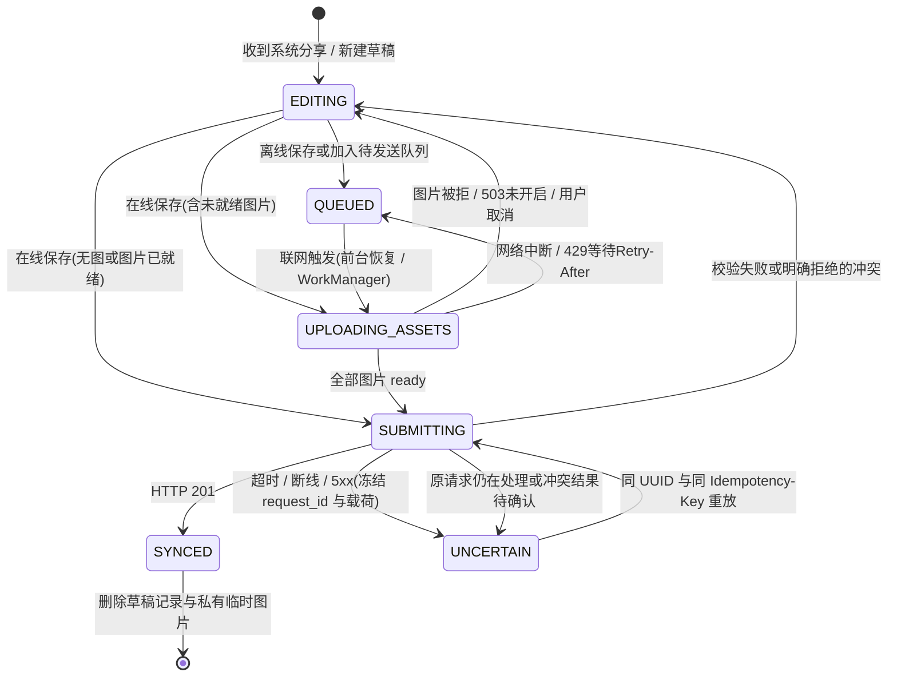

# Spark 移动端架构与工程设计（Android & iOS）

| 项 | 内容 |
| --- | --- |
| 状态 | 设计评审（已完成三轮对抗审查修订，待确认后实施） |
| 版本 | v1.1，2026-11-21 |
| 适用范围 | `apps/android/`（近期重构）与规划中的 `apps/ios/`（独立原生线），以及 `apps/web/` 的移动端宿主适配层 |
| 关联文档 | [产品需求](../PRODUCT.md)、[系统架构](../ARCHITECTURE.md)、[接口说明](API.md)、[数据设计](DATA.md)、[Web 交互设计](WEB.md)、[Web 视觉规范](WEB-VISUAL.md)、[决策记录](../DECISIONS.md)、[v0.7 计划](../releases/v0.7.md)、[Android v0.3 实现交接](../releases/android-v0.3.md)、[OpenAPI](../../contracts/openapi.json) |

本文定义 Spark 移动端（Android 与 iOS）的长期架构选型、职责边界、平台中立桥接协议、原生收集引擎、离线草稿状态机、安全与鉴权演进、视觉对齐规范及分阶段实施路线，是移动端研发与 Web 宿主适配的唯一设计事实来源。

---

## 1. 现状事实与设计目标

### 1.1 当前代码事实（2026-11-21）

- **Android（`main` 分支）**：停留在 v0.1.0 原型（6 个 Java 文件、零外部依赖），仅支持纯文本 `ACTION_SEND` 分享、手写 `LinearLayout` 表单与原生三按钮顶栏；缺少 `WebChromeClient` 文件选择器、文件下载、图片分享、项目与标签选择、深浅色主题联动、自适应图标及自动化测试。
- **Android 历史分支**：远端分支 `origin/feat/android-mobile-shell`（未合入 `main`）移除了顶栏、加入了 `SparkAndroid/2` UA 声明、安全路由白名单 `WebNavigation`、登录成功自动回跳草稿与基础深色色值；Web 端已合入对应的 `/android/local-drafts` 入口与 `.sp-app-root--android-subpage` 样式，导致主干双端割裂。
- **iOS**：尚未立项或建目录，后续必建。
- **在线 Web 与后端**：已演进至 v0.7.0（schema v16），具备图片上传与识别、网页提取、标签与项目、四套主题配色、PNG 分享卡片、整理模式、灵光日历与笔记续写等完整在线能力。

### 1.2 设计目标

1. **体验接近全原生**：冷启动、系统栏、相册选图、导出下载、分享卡片发往外部应用、系统级跨 App 收集均达到成熟移动应用水准。
2. **多端可持续维护**：在不制造双倍页面开发负担的前提下，让 Android 与未来 iOS 共用同一套产品主线、契约与 Web 工作区，且不引入沉重的跨端运行时风险。
3. **安全与数据可靠性不倒退**：继承并强化现有账号作用域隔离、不可变会话快照、提交前冻结幂等键与离线草稿防丢失机制。
4. **面向未来可平滑演进**：当后端完成 M6/M7 增量同步（`/sync/changes`）后，原生核心层可直接扩展为离线优先原生页面，无需推倒重来。

---

## 2. 多端战略：Android 与 iOS 是兼容还是分线？

### 2.1 四种路线评估

| 路线 | 工作区形态 | 原生收集与 OS 集成 | 维护成本与风险 | 结论 |
| --- | --- | --- | --- | --- |
| A. 跨平台 UI 框架（React Native / Flutter）全量重写 | 双端重写全部 10+ 页面 | 仍需原生编写 Android 分享入口与 iOS Share Extension | 极高：与高速演进的 Web 形成双份维护；且 iOS Share Extension 进程仅有 **120 MiB 内存红线**，嵌入跨平台 UI 引擎极易 OOM 崩溃或冷启卡顿 | **不采用** |
| B. 跨平台 UI 框架套 WebView | 复用 Web | 仍需手写双端原生桥接与 Share Extension | 差：同时背负跨平台引擎与 WebView 双重运行时开销，得不到实际收益 | **不采用** |
| C. KMP 共享业务层 + 双原生 UI | 复用 Web | Android Kotlin + iOS Swift，通过 XCFramework 共享逻辑 | 中偏高：当前混合架构下原生非 UI 逻辑仅约 6–8 个小模块，引入 KMP 反而带来 Gradle/Xcode 工具链耦合、Swift 并发桥接成本及非 macOS 机器调试负担 | **当前不引入；待 M7 离线同步复杂度上升后再评估** |
| D. **统一协议 + 双原生轻量工程**（推荐） | **共用在线 Web 工作区** | **Android（Kotlin + Compose）与 iOS（Swift + SwiftUI）各开独立原生线** | **最优**：Web 承担 80% 高频变化的工作区界面；两端原生各聚焦 20% 系统融合与收集引擎，契约、桥接、状态机与视觉令牌四项完全统一 | **采纳（见 [D-0018](../DECISIONS.md#d-0018-移动端采用统一契约与双原生轻量工程)）** |

### 2.2 结论：「协议与工作区强统一，原生工程双线独立」

- **工程分线**：
  - Android 独立维护在 `apps/android/`（Kotlin + Jetpack Compose + Material 3 + Room + OkHttp）；
  - 未来 iOS 独立维护在 `apps/ios/`（Swift + SwiftUI + `WKWebView` + SQLite/GRDB + `URLSession`），与 Android 各自发挥平台原生能力，避开 iOS Share Extension 120 MiB 内存限制与生态兼容风险。
- **四项强统一资产（Android / iOS / Web 共同遵守）**：
  1. **在线工作区**：全部列表、详情、项目、搜索、整理模式、续写、设置复用 `apps/web/`，Web 发版双端即时生效。
  2. **服务端数据与接口契约**：共同遵守 [openapi.json](../../contracts/openapi.json) 与 [document.schema.json](../../contracts/document.schema.json)。
  3. **平台中立的 Web ↔ 移动端桥接协议**（第 4 节）：Web 只感知能力声明，不做平台特化分叉。
  4. **统一的行为与视觉规范**（第 5、7 节）：相同草稿状态机、相同校验与幂等规则、相同「灵光手帐」四套配色与项目纸胶带色映射算法。

---

## 3. 职责边界：Web 工作区 vs 原生层

| 能力域 | 归属 | 说明 |
| --- | --- | --- |
| 收件箱、全部收藏、待归类、整理模式、项目、搜索、详情与续写、日历、回收站、设置、管理后台 | **Web 工作区** | 统一路由与移动底部悬浮坞，沿用 [WEB.md](WEB.md) 与 [WEB-VISUAL.md](WEB-VISUAL.md) |
| 系统启动页、自适应图标、Edge-to-Edge 与状态栏/导航栏主题同步 | **原生层** | 消除白屏、黑边与导航栏割裂 |
| 系统跨 App 分享（文字、链接、标题、单图/多图）与悬浮底部弹窗收集卡片 | **原生层** | 在其他 App 之上直接滑出，保存完回到原 App |
| 本地离线草稿存储、临时媒体拷贝、断网队列与可靠续传 | **原生层** | 账号隔离、发送前冻结幂等键、恢复联网后可靠投递 |
| 本机草稿箱界面 | **原生层** | 从 Web「更多 → 本机草稿」及系统桌面快捷方式进入 |
| 系统相册/文件选择器、认证数据导出下载（ZIP）、分享卡片 PNG 存相册与调用系统分享 | **原生层（经桥接提供给 Web）** | 补齐裸 WebView 缺失的操作系统能力 |
| 桌面微件（Widget）、下拉快捷磁贴 / iOS 控制中心与快捷指令 | **原生层（后续阶段）** | 进一步降低手机端随手记录门槛 |

---

## 4. 平台中立的 Web ↔ 移动端桥接协议

原则：**最小暴露、精确同源、版本可演进、旧版可降级**。禁止向任意页面暴露通用原生执行接口，禁止用不安全的全局脚本注入拼接数据。

### 4.1 宿主识别、能力声明与子页顶栏策略

- 新版移动端在 WebView User-Agent 末尾追加平台中立标记：`SparkMobile/1`。
- **向后兼容**：`apps/web/` 同时识别 `SparkMobile/1` 与旧版 `SparkAndroid/2`，保留既有 Android 0.2.0 打包版本的 `/android/local-drafts` 入口；新版原生端同时拦截 `/mobile/local-drafts` 与 `/android/local-drafts`。
- **子页顶栏与返回策略**：
  - Web 端现有 `.sp-app-root--android-subpage` 会隐藏非收件箱页面的顶部栏。进入 `SparkMobile/1` 后，该样式收敛为基于宿主能力控制，并必须确保：**Web 子页始终保留明确页内返回按钮**，同时 Android 接入预测性返回栈（`WebView.canGoBack()`）、iOS 开启 `WKWebView.allowsBackForwardNavigationGestures = true`，避免在无实体返回键的 iOS 设备上出现无路可退。

### 4.2 安全路由与导航白名单（Android / iOS 同构）

每次主文档导航均经统一决策器判定（完整继承并升级 `WebNavigation` 规则）：

| 目标特征 | 动作 | 安全约束 |
| --- | --- | --- |
| 精确同源 HTTPS（`scheme == https` 且 `authority == ORIGIN`），普通路径的主文档 GET | `WEB`（WebView 内部加载） | 禁止降级 HTTP；禁止子域名模糊匹配 |
| 精确同源 + 路径为 `/mobile/local-drafts` 或 `/android/local-drafts` + 无查询参数/片段 + 用户手势触发的 GET | `LOCAL_DRAFTS`（打开原生本机草稿箱） | 必须校验当前页面也属于同源，防止重定向触发 |
| 非同源 `http(s)` + 无凭据（`userInfo == null`）+ 主框架 + 用户手势触发的 GET + 非重定向 | `BROWSER`（拉起系统默认浏览器） | 防止页面静默拉起外部 App 或钓鱼跳转 |
| 其他情况（含主文档 POST、`file://`、`content://`、`javascript:`、非法 scheme） | `BLOCK`（拦截） | Android 在 `shouldInterceptRequest` 阻断主文档 POST 首跳，防止 307/308 重定向携带表单内容跨源。iOS 通过 `WKNavigationDelegate` 作同样限制。Web 的 API 请求与 OSS 上传照常使用子资源请求。 |

### 4.3 受控双向消息通道

- **传输机制**：
  - Android：`WebViewCompat.addWebMessageListener(webView, "sparkMobileHost", setOf(ORIGIN), listener)`（系统底层保证仅精确同源脚本可见）。
  - iOS：`WKUserContentController.add(handler, name: "sparkMobileHost")` + 处理器强制校验 `message.frameInfo.isMainFrame && message.frameInfo.securityOrigin == ORIGIN`。
- **统一消息格式**（UTF-8 JSON，严格校验字段与并发门控：文件导出/保存/分享类动作同一时间仅允许 1 个在途请求，防连点引发内存峰值）：
  ```json
  {
    "version": 1,
    "request_id": "可选，仅需回执的动作携带",
    "action": "syncAppearance | openLocalDrafts | saveImage | shareImage | exportData | authStateChanged | cancelFileAction",
    "payload": {}
  }
  ```
- **允许动作白名单**：

| `action` | 方向 | `payload` 与限制 | 原生行为 | 旧客户端/普通浏览器降级 |
| --- | --- | --- | --- | --- |
| `syncAppearance` | Web → Native | `{ "palette": "mint\|sea\|matcha\|sakura", "mode": "light\|dark", "bg_hex": "#rrggbb" }` | 实时更新状态栏/导航栏底色与浅深图标，并缓存为下次冷启动默认外观 | 普通浏览器仅更新 `<meta name="theme-color">` |
| `openLocalDrafts` | Web → Native | `{}` | 打开原生本机草稿箱（`LocalDraftsActivity` / iOS Drafts 视图） | 降级为同源链接 `/android/local-drafts` |
| `saveImage` | Web → Native → Web | `{ "expected_user_id": "<uuid>", "mime": "image/png", "filename": "≤64 字符安全文件名", "base64": "原始字节 ≤ 4 MiB" }` | 校验 PNG 魔数后写入私有暂存，复核会话后保存至系统相册或所选位置 | 普通浏览器使用 `<a download>` |
| `shareImage` | Web → Native → Web | `{ "expected_user_id": "<uuid>", "mime": "image/png", "filename": "≤64 字符安全文件名", "base64": "原始字节 ≤ 4 MiB" }` | 校验 PNG 魔数后写入私有临时文件，复核会话后拉起系统分享面板，延迟清理临时文件 | 普通浏览器走 `navigator.share` 或下载 |
| `exportData` | Web → Native → Web | `{ "expected_user_id": "<uuid>", "format": "markdown\|json" }` | 同源不可变会话请求 `GET /api/v1/me/export?format=...`，ZIP 流式写入私有暂存后发布。响应通过 `data.filename` 返回文件名，限流通过 `error.retry_after` 返回等待秒数 | 普通浏览器走 `fetch` + `Blob` + `<a download>` |
| `authStateChanged` | Web → Native | `{ "authenticated": true\|false }` | 触发原生层执行 Cookie 落盘（`CookieManager.flush()`）、刷新会话指纹与外观缓存；若当前处于草稿登录往返流程则触发回跳校验（原生层不信任其携带的用户信息，仍以服务端 `/auth/session` 为准） | 无副作用 |
| `cancelFileAction` | Web → Native | `{ "request_id": "<待取消文件请求 ID>" }`，信封不带 `request_id` | 仅取消发起文档内匹配的文件任务，无回执 | 无副作用 |

- 三个文件动作都须带信封 `request_id`。`expected_user_id` 取自发起页面的已登录用户，仅用于一致性断言。原生通过 `/auth/session` 验证 Cookie 快照和用户 UUID，同时检查文档世代。账号变更返回 `account_mismatch`，未登录或会话失效返回 `session_expired`。
- 页面卸载、Web 主动取消或等待超时发送 `cancelFileAction`。Android 在主文档导航、WebView 分离或渲染进程退出时取消在途任务，关闭连接或流，待清理完成后释放文件动作槽。系统选取器或分享面板引起 Activity 暂停时继续等待结果。
- Android 先在私有缓存中准备图片或 ZIP。导出限制实际写入 256 MiB，写入期间保留至少 64 MiB 可用空间，并由启动与定期任务回收失去持有者的暂存文件。Android 10+ 在清除 `IS_PENDING` 前复核，失败时删除待定条目。Android 7–9 的 SAF 在写入前后复核，失效时尝试删除，回滚能力取决于外部 provider。

> **关键设计说明（为什么 `exportData` 不走 `DownloadListener` 也不走 Base64）**：实查 [DataExport.tsx](../../apps/web/src/components/DataExport.tsx) 可知，Web 导出必须携带 `X-CSRF-Token` 请求头，实际通过 `fetch` 取回 `Blob` 后生成 `blob:` URL 触发 `<a download>`。Android `DownloadListener` 无法用 `OkHttp` 或 `DownloadManager` 读取 WebView 内部 `blob:` URL；而把可能数十 MiB 的账号导出 ZIP 编码为 Base64 跨桥传输又会导致 OOM。因此由 Web 侧在检测到 `SparkMobile/1` 时直接发送 `exportData` 指令、交由原生流式请求并落盘，是兼顾安全（完整 CSRF + 会话）、内存（常量流式缓冲）与 429 倒计时一致性的唯一稳健方案。

### 4.4 文件选择与登录往返契约

- **文件选择**：
  - Android：`WebChromeClient.onShowFileChooser` 按 `acceptTypes` 分流，图片类优先使用系统 `PickVisualMedia` / `PickMultipleVisualMedia`（Android 13+ 零权限，低版本自动降级），其他文件（如管理后台 CSV）使用 `ACTION_OPEN_DOCUMENT`；取消或任何异常路径均保证回调 `onReceiveValue(null)`，防止 WebView 文件选择永久失效。
  - iOS：`WKWebView` 原生支持 `<input type="file">`，配合 `Info.plist` 声明相册/相机用途文案。
- **登录往返自动回跳草稿**：
  - 继承 `feat/android-mobile-shell` 的登录闭环：从收集卡片触发登录打开 `WebActivity`（传入显式结果调用）时，记录初始会话指纹 `loginStartedIn`；当 `doUpdateVisitedHistory` / `onPageFinished`（或收到 `authStateChanged`）检测到进入 `/inbox` 且当前会话指纹变为非 `GUEST` 且与 `loginStartedIn` 不同时，自动结束登录页并返回草稿页，由草稿页向服务端重新校验新会话后再安全认领未绑定草稿。

---

## 5. 原生收集引擎与离线草稿状态机（跨端统一行为）

### 5.1 系统分享输入规范与防滥用边界

| 输入类型 | Android Intent | iOS Share Extension (`NSExtensionActivationRule`) | 处理与安全边界 |
| --- | --- | --- | --- |
| 纯文本 / 网页链接 | `ACTION_SEND` (`text/plain`) | `public.plain-text`、`public.url` | 同时读取 `EXTRA_TEXT` 与 `EXTRA_SUBJECT`（仅当正文为纯 URL、标题单行且 ≤ 200 字符且不含 URL 时，沿用 `SharedText` 合并为「标题\n网址」）；读取长度硬上限 `100,000` UTF-16 码元，剥离发送方富文本 span |
| 单张图片 | `ACTION_SEND` (`image/*`) | `public.image` (max 1) | IO 线程流式拷贝至应用私有目录，读到第 `5 MiB + 1` 字节即中止并删残文件，按真实文件头魔数校验（JPEG/PNG/GIF/WebP） |
| 多张图片 | `ACTION_SEND_MULTIPLE` (`image/*`) | `public.image` (max 9) | 超过 9 张时明确提示仅保留前 9 张或请分批收藏；逐张流式限额拷贝与魔数校验，不合格项展示具体原因并支持移除 |
| 图文混合 | `ACTION_SEND` / `ACTION_SEND_MULTIPLE` 同时含 `EXTRA_TEXT` | 同时含文本与图片 | 先持久化正文和图片条目，再导入图片。Android 单张读取截止时间为 15 秒，进程最多执行两张外部图片读取。失败条目可移除，分享窗口保有原分享 URI 授权时可重试 |

### 5.2 宿主分离与悬浮底部卡片交互规范

- **明确拆分两个原生入口，禁止混用任务栈**：
  1. **系统分享入口（`ShareCaptureActivity`）**：透明背景主题 + Compose `ModalBottomSheet`（iOS 为 `SparkShareExtension` 的 SwiftUI Sheet），`excludeFromRecents="true"`，**严禁在 Manifest 固定 `screenOrientation`**（避免 Android 8.0 透明 Activity 抛出 `IllegalStateException` 闪退），不拉起主工作区任务栈；保存完成或手势关闭后直接回到原 App。
  2. **本机草稿箱（`LocalDraftsActivity`）**：标准不透明全屏页面，承载未提交草稿列表、继续编辑、新建随手记与状态重试，从 Web「更多 → 本机草稿」及桌面长按快捷方式进入。
- **卡片信息层级**（遵循「收集先于整理」）：
  1. **顶栏**：标题「收藏到 Spark」、当前账号标识（或未登录提示）、关闭按钮；
  2. **核心输入区**：正文多行输入（实时逼近 50,000 字时提示）+ 图片横向缩略图条（单张展示上传进度、失败原因、重试与移除 `×`）；
  3. **轻量归类行**：横向可滚动的「+ 项目」（已选显示对应纸胶带色胶囊）与「+ 标签」（已有标签搜索选择）；
  4. **折叠次级项**（展开输入，收起不丢）：「补一句用途」「可选标题」「本条不参与 AI 整理」；
  5. **底部操作条**：左侧状态文案（自动防抖保存草稿，不重建 View 树、不抢焦点、不引起软键盘跳动），右侧主色「保存」按钮（断网时显示「存为待发送草稿」）。

### 5.3 对接服务端完整链路（严格对齐 Web 语义）

1. **项目与标签目录缓存**：
   - 会话校验后按需拉取 `GET /api/v1/projects?state=active&limit=100` 与 `GET /api/v1/tags?limit=100`，按 `user:<uuid>` 存入本地只读缓存表（TTL 10 分钟），分享弹起时优先毫秒级展示缓存并后台静默刷新；无网时仍可选用已缓存条目。
2. **图片三步上传（精准对齐 [API.md 附件时序](API.md#附件时序) 与 [uploads.ts](../../apps/web/src/lib/uploads.ts)）**：
   - 每张本地草稿图片持有稳定 `asset_id`、固定 `upload_idempotency_key` 与 `bytes_transferred` 标记：
   - **Step 1**：`POST /api/v1/uploads`（`Idempotency-Key`、`X-CSRF-Token`、`filename`（规范化 ≤ 200 字符）、`mime_type`、`size_bytes`）；弱网或 429 重试**保留原 `upload_idempotency_key`**，避免重复消耗每账号每日 40 次上传配额；
   - **Step 2**：流式 PUT 到 OSS 授权 URL（携带服务端返回的精确 `headers`），完成后持久化 `bytes_transferred = true`；
   - **Step 3**：`POST /api/v1/uploads/{id}/complete`（返回 202）→ 退避轮询 `GET /api/v1/uploads/{id}` 至 `ready`。
   - **精确失败与恢复分支**：
     - 若 `bytes_transferred == true` 且已有 `upload_id`，重试直接跳至 `POST /uploads/{id}/complete` 或 `GET /uploads/{id}`，不再重复上传字节；
     - 若已有 `upload_id` 且本机尚未记录 PUT 成功，先 `GET /uploads/{id}`。服务端确认 `verifying`、`ready` 或 `attached` 时跳过 PUT，`pending` 仍按原键上传；
     - 若收到 `status == rejected` / `expired` 或 `409 upload_not_pending` / `410 upload_expired` / `404`，**轮换新的 `upload_idempotency_key`** 并重置 `bytes_transferred = false`、`upload_id = null`，允许重新申请上传；
     - 若 `GET /uploads/{id}` 返回 `status == attached` 且所属草稿处于 `UNCERTAIN`（已有冻结 `request_id`），说明上次 `POST /collections` 可能已在服务端成功但响应丢失，**不得标为图片失效**，应核对 `GET /collections/{request_id}` 或直接用原冻结 `request_id` 重放 `POST /collections`；
     - 若 `POST /uploads` 返回 `503 integration_not_configured`，明确提示「当前环境未开启图片上传，移除图片后仍可保存正文或网址」，**禁止后台无限重试**。
3. **收藏提交**：
   - 全部所选图片均 `ready` 后，携带冻结的客户端 UUID（同作 `id` 与 `Idempotency-Key`）、`document`、`original_url`、`manual_title`、`intent`、`upload_ids`、`project_ids`、`tag_ids`、`ai_excluded` 提交 `POST /api/v1/collections`。

### 5.4 离线草稿状态机与生命周期



收藏创建收到 `409 operation_in_progress` 或冲突结果仍不确定时，保留原内容和 `request_id`。明确拒绝的 `duplicate_resource`、`idempotency_mismatch` 及校验失败可解冻，修正后使用新的 UUID。当前阶段的待发送草稿可在草稿箱手动发送。[决策记录](../DECISIONS.md#d-0020-按收藏提交的确定结果解冻草稿)

- **孤儿媒体清理**：应用启动及定期任务扫描 `noBackupFilesDir/draft-media/`，删除不再被数据库 `draft_asset` 引用的全部文件，防止存储泄漏。

### 5.5 跨端确定性行为对齐（Web / Android / iOS 一致）

以下纯函数规则在两端用完全一致的算法实现并配备相同的单元测试样例：

1. **字符上限与非法字符**：按 Unicode 码点（Kotlin `codePointCount` / Swift `unicodeScalars.count`）计算正文与用途合计 `≤ 50,000`，拒绝 `U+0000` 与孤立代理项。
2. **富文本与纯图空文档封装**（对齐 [content.go](../../server/internal/backend/content.go) 与 [document.schema.json](../../contracts/document.schema.json)）：
   - 将 `\r\n` / `\r` 规范为 `\n`，节点总数 `≤ 10,000`，整包 UTF-8 字节 `≤ 1 MiB`；
   - 无图片时，正文或 `original_url` 至少有一项非空白；
   - **纯图片收藏（有图片且正文为空）**：允许正文为空，必须编码为单个空段落 `{"schema_version":1,"content":{"type":"doc","content":[{"type":"paragraph"}]}}`（禁止空 `content: []`）。
3. **主网址提取**：提取正文首个合法 `http(s)` 链接（长度 `≤ 4,096` 码点、无 `userInfo`、剥离成对之外的尾部中英文标点）。
4. **项目纸胶带色映射**（对齐 [projectTone.ts](../../apps/web/src/lib/projectTone.ts) 并规避 32 位最小值溢出崩溃）：
   - 初始 `hash = 0`（32 位有符号整数）；逐 UTF-16 码元计算 `hash = (hash * 31 + codeUnit)`（32 位截断溢出，Kotlin 使用 `Int`，Swift 使用 `Int32` 与 `&*`/`&+`）；
   - **必须先扩位至 64 位整数再取绝对值**：Kotlin `((kotlin.math.abs(hash.toLong()) % 6L) + 1L).toInt()`，Swift `Int((abs(Int64(hash)) % 6) + 1)`。禁止直接对 `Int32.min` / `Int.MIN_VALUE` 调用 32 位 `abs`（会导致 Swift 崩溃或 Kotlin 得出负下标）。

---

## 6. 安全边界与两阶段鉴权演进（兼顾 iOS 进程隔离限制）

### 6.1 必须守住的四条安全不变量

1. **账号作用域严格隔离**：草稿与项目/标签缓存均绑定 `scope`（`guest` / `pending:<cookie_sha256>` / `user:<uuid>`）。本地数据库绝不持久化明文会话 Cookie 或密码；未登录创建的草稿仅允许在显式登录往返后认领到新账号，已绑定草稿切换账号后不可见、不可修改；登出或切号时及时清理旧账号的非草稿只读缓存，并执行 `CookieManager.flush()`。
2. **不可变会话快照**：每次校验会话到提交图片与收藏，全程锁定同一份不可变凭据快照，防止 WebView 后台切号导致跨账号写入。
3. **提交前冻结幂等键**：在首次可能发出 `POST /collections` 前持久化并冻结 `request_id`，不确定结果的重试均原样重放，杜绝重复创建。
4. **最小存储暴露**：Android 保持 `android:allowBackup="false"`、`android:usesCleartextTraffic="false"`，数据库与临时图片放入 `noBackupFilesDir`；草稿编辑页与草稿箱启用 `FLAG_SECURE` 防止最近任务预览泄露草稿内容。

### 6.2 两阶段鉴权演进

| 阶段 | 鉴权方式 | 适用范围 | 优势与运行时边界 |
| --- | --- | --- | --- |
| **Phase 1（Android 重构首期，零后端改动）** | 复用 WebView 同源 `spark_session` Cookie + `GET /api/v1/auth/session` 取 `csrf_token` | Android `WebActivity`、`ShareCaptureActivity`、`LocalDraftsActivity` | 零后端改动即可交付完整 Android 升级。**运行边界**：在后台 `WorkManager` 进程中访问 `CookieManager` 可能受个别定制 ROM 限制，Worker 必须捕获初始化异常并静默保持 `QUEUED`，待回到前台立即触发续传，绝不崩溃或丢草稿；**此方式不适用于 iOS Share Extension** |
| **Phase 2（iOS 立项前置条件 & Android 后台彻底脱耦）** | **移动端设备级可撤销访问令牌**（对齐 [v0.7 扩展凭据模型](../releases/v0.7.md#第二批接口与交互设计)） | iOS 主 App + **iOS Share Extension（独立进程）** + Android `WorkManager` / Widget | 令牌存于 Android Keystore（EncryptedSharedPreferences）与 iOS App Group Shared Keychain；Web 设置页可查看并单独撤销设备会话，重置密码一并撤销。彻底解决 iOS Share Extension 无法读取 `WKWebView` `HttpOnly` Cookie 的系统级限制，并让 Android 后台任务脱离 WebView 进程依赖 |

> **代码边界约束**：原生代码必须将鉴权封装在单一接口 `SessionCredentialProvider` 之后。Phase 1 实现为 `WebViewCookieCredentialProvider`，Phase 2 切换为 `DeviceTokenCredentialProvider`，上层 API 客户端、上传器、草稿状态机与 UI **零改动**。

---

## 7. 「灵光手帐」原生视觉与品牌对齐

原生界面（启动页、分享底部弹窗、本机草稿箱、错误页）统一遵循 [WEB-VISUAL.md](WEB-VISUAL.md) 与 [tokens.css](../../apps/web/src/styles/tokens.css)：

1. **四套配色 × 明暗模式令牌**：完整内置 `mint`（薄荷晨雾，默认）、`sea`（海盐蓝）、`matcha`（抹茶奶白）、`sakura`（樱花雾粉）的浅色与深色色值。启动时读取持久化缓存外观；`GET /api/v1/auth/session` 的 `user.palette`/`user.theme` 与 Web `syncAppearance` 消息实时同步。
2. **六种项目纸胶带色**（与 `tokens.css` 完全一致）：
   - 浅色：`#ffd9c7/#7a3a22`、`#cdebdd/#1f5e48`、`#d3e6f7/#24527d`、`#ffefb0/#6b5300`、`#e3dcf5/#4b3c80`、`#f8d7df/#8a3a4e`；
   - 深色：`#4a3027/#f7cdb9`、`#1f3d33/#bfe8d6`、`#213448/#c5ddf3`、`#463c17/#f3e3a0`、`#322b4a/#d6ccf2`、`#45272f/#f5c9d4`。
3. **品牌图标**：基于 [Brand.tsx](../../apps/web/src/components/Brand.tsx) 的小玻璃瓶（`JarGlyph`）制作矢量资源：
   - Android：标准 Adaptive Icon（`mipmap-anydpi-v26`，前景玻璃瓶 + 薄荷绿背景 + Android 13+ Monochrome 单色图层），替换旧版绿底闪电 `ic_spark.xml`；
   - iOS：标准 `AppIcon` 与暗色/色调变体。
4. **触控与无障碍**：主要操作目标高度 `≥ 48dp` / `44pt`，支持系统字体缩放、读屏语义标签与系统「减少动效」偏好。

---

## 8. Android 工程重构蓝图（`apps/android/`）

### 8.1 构建与环境矩阵

- **JDK 与 SDK**：JDK 17、AGP 8.7+、Kotlin 2.0+、`compileSdk = 35`、`targetSdk = 35`、`minSdk = 24`（Android 7.0+）。
- **依赖管理**：使用 `gradle/libs.versions.toml` 集中锁定版本；核心依赖限于：
  - `androidx.core:core-ktx`、`androidx.core:core-splashscreen`、`androidx.activity:activity-compose`
  - `androidx.compose:compose-bom`（`material3`、`ui`、`ui-tooling`、图标按 R8 裁剪）
  - `androidx.webkit:webkit`
  - `androidx.room:room-runtime`、`androidx.room:room-ktx`、`androidx.room:room-compiler`（KSP）
  - `androidx.work:work-runtime-ktx`
  - `com.squareup.okhttp3:okhttp`、`org.jetbrains.kotlinx:kotlinx-serialization-json`、`io.coil-kt`
- **构建变体**：
  - `prod`：`SPARK_ORIGIN = "https://spark.stwqy.cloud"`，`applicationId = "cloud.stwqy.spark"`（保持包名不变，支持无缝覆盖升级），严禁明文 HTTP；
  - `dev`：`SPARK_ORIGIN` 从 `local.properties` 读取（默认 `http://10.0.2.2:5173` 或自建测试 HTTPS 域），`applicationIdSuffix = ".dev"` 同机共存，仅 `dev` 变体放行受控测试回环地址。
- **发布压缩**：`release` 启用 `isMinifyEnabled = true`、`isShrinkResources = true`，维护明确的 R8 规则并导出 Room Schema JSON（`exportSchema = true`）。

### 8.2 数据库 Schema 与老版本无损迁移（关键防崩设计）

沿用 `noBackupFilesDir/share-drafts.db` 路径。旧版 `ShareDrafts.java` 的建表语句保留在 [迁移测试](../../apps/android/app/src/test/java/cloud/stwqy/spark/core/storage/ShareDraftsMigrationTest.kt)，其中 `draft.id TEXT PRIMARY KEY` 缺少 `NOT NULL`、索引 `draft_scope` 带 `DESC`、`verified_session` 含 `CHECK(slot=1)`。直接 `ALTER TABLE` 会触发 Room 严格 Schema 校验崩溃！

因此 `Migration(1, 2)` **必须采用 SQLite 标准建新表拷贝迁移法**：
1. 按 [Room v2 精确结构](../releases/android-v0.3.md#42-五张表精确结构room-v2) 创建 `draft_new`（保留含 `modified` 的原有 8 列，新增 `manual_title`、`status`、`project_ids_json`、`tag_ids_json`、`last_error`）与 `verified_session_new`（含 `palette`、`theme`）；
2. 将旧表有效行拷贝入新表：已有 `request_id IS NOT NULL` 的草稿映射为 `status = 'UNCERTAIN'`，其余为 `status = 'EDITING'`；
3. `DROP TABLE` 旧表 → `ALTER TABLE ... RENAME TO ...` → 按 Room 规范重建索引；
4. 新建 `draft_asset`（含 `upload_idempotency_key`、`bytes_transferred`、`upload_id`、`upload_state`、`sort_order`、`error_message`，外键级联删除 `draft(id)`）、`cached_project` 与 `cached_tag` 表（按 `scope` 隔离）。

严禁使用 `fallbackToDestructiveMigration()` 静默清空用户未提交草稿。

### 8.3 测试与 CI 防线

- **JVM 单元测试与迁移测试**：
  - `CollectionPayloadTest`：UTF-16 代理对 50,000 码点边界、纯图空文档单段落结构、10,000 节点、1 MiB 上限、NUL/孤立代理拒绝、URL 抽取边界与 `SharedText` 标题合并；
  - `ProjectToneTest`：与 Web 固定样本 ID（含触发 `Int.MIN_VALUE` 边界的用例）1–6 色号逐一比对；
  - `WebNavigationTest`：同源、外链、重定向、表单 POST 拦截、非法 scheme、`/mobile/local-drafts` 与 `/android/local-drafts`；
  - `DraftRepositoryTest` & `SparkApiTest`（`MockWebServer`）：账号隔离、未登录草稿认领、跨账号拒绝、提交前冻结、超时重放、400/422 解冻、图片三步上传（含 `bytes_transferred` 续传、`attached` 恢复、`expired`/409 轮换幂等键、503 降级）、`exportData` 流式导出与 429 `Retry-After`；
  - `ShareDraftsMigrationTest`：用旧版 v1 原始 SQL 建库并写入普通与冻结草稿，实测 `Migration(1, 2)` 数据完整与 Room Schema 校验通过。
- **CI 集成**：在 [.github/workflows/verify.yml](../../.github/workflows/verify.yml) 增加独立 `android` Job（沿用仓库规范，所有 GitHub Actions 锁定 40 位 commit SHA），执行 `./gradlew :app:testProdDebugUnitTest :app:assembleProdDebug`，防止 Android 工程再次脱离主干失修。

---

## 9. iOS 独立原生线规划要点（`apps/ios/` 预留）

当 Phase 2 设备令牌就绪、具备 macOS / Xcode 打包与 Apple Developer 账号后，启动 `apps/ios/` 独立工程：

- **技术栈**：Swift 6 + SwiftUI + `WKWebView` + `URLSession`（含 Background Session）+ SQLite（GRDB）+ App Groups + Shared Keychain，最低系统版本建议 iOS 16+。
- **Target 结构**：
  - `SparkApp`（主应用：WebView 宿主、本机草稿箱、外观与下载/分享桥接）；
  - `SparkShareExtension`（系统分享扩展：复用同一共享 Swift Package `SparkCore`，专注轻量化收集卡片，**严格将峰值内存控制在 60 MiB 以内**以远离 120 MiB 系统终止线，多图预览使用 `CGImageSourceCreateThumbnailAtIndex` 降采样解码）。
- **数据共享**：主 App 与 Share Extension 通过 App Group 共享 SQLite 数据库与私有媒体目录，通过 Keychain Access Group 共享 Phase 2 设备令牌。
- **应用商店审核准备**：原生提供 Share Extension（图文多图收集 + 项目/标签选择）、离线草稿队列、原生相册保存与系统分享、桌面小组件与快捷指令入口，体现明确的系统级原生价值。

---

## 10. 分阶段实施路线与验收标准

### 10.1 阶段与任务拆分

| 阶段 | 编号 | 任务 | 模块 | 规模 | 依赖 | 后端改动 |
| --- | --- | --- | --- | --- | --- | --- |
| **Stage 1：底座重构与 WebView 融合** | `MOB-S1-T01` | 吸收 `feat/android-mobile-shell` 安全路由与登录回跳逻辑，重构 Gradle（Kotlin 2 + Compose + Material 3 + Room + OkHttp + Version Catalog + `dev`/`prod` 变体），制作小瓶子自适应图标与 SplashScreen | `apps/android` | M | 本设计评审通过 | 无 |
| | `MOB-S1-T02` | 重构 `WebActivity`：补齐 `WebChromeClient` 文件/相册选择、`WebViewCompat` 安全桥接（见 §4.3）、Edge-to-Edge 与状态栏联动、错误页与进度条 | `apps/android`、`apps/web`（极薄桥接适配） | M | `MOB-S1-T01` | 无 |
| | `MOB-S1-T03` | 补齐核心单测（路由、Payload、色号、导出、`Migration(1, 2)`）并接入 `verify.yml` CI | `apps/android`、`.github/workflows` | S | `MOB-S1-T01` | 无 |
| **Stage 2：原生收集卡片与草稿箱** | `MOB-S2-T01` | Compose 实现独立透明宿主 `ShareCaptureActivity` 悬浮底部弹窗卡片（文字/链接/`EXTRA_SUBJECT`/用途/可选标题/排除 AI）+ 四套「灵光手帐」主题同步 | `apps/android` | M | `MOB-S1-T02` | 无 |
| | `MOB-S2-T02` | 接入活跃项目与标签的账号隔离缓存、纸胶带选择器及独立全屏 `LocalDraftsActivity` 本机草稿箱与状态机 | `apps/android` | M | `MOB-S2-T01` | 无 |
| **Stage 3：系统图片分享与后台可靠投递** | `MOB-S3-T01` | 支持 `ACTION_SEND` / `ACTION_SEND_MULTIPLE` 单图与多图（≤9 张）、流式 `5 MiB` 限额拷贝与魔数校验、纯图空文档编码、OSS 三步上传进度与单张恢复 | `apps/android` | L | `MOB-S2-T02` | 无 |
| | `MOB-S3-T02` | 接入 `WorkManager` 离线续传（含 Phase 1 Cookie 防御降级）、孤儿媒体清理与弱网/429/切号/`attached` 恢复回归测试 | `apps/android` | M | `MOB-S3-T01` | 无 |
| **Stage 4：跨端鉴权统一与 iOS 启动** | `MOB-S4-T01` | 后端与移动端接入可撤销设备访问令牌（对齐 v0.7 扩展凭据模型），Android 切换至 Keystore 令牌彻底脱离后台 Cookie 依赖 | `contracts`、`server`、`apps/android` | M | v0.7 第二批凭据方案定稿 | 有（复用扩展模型） |
| | `MOB-S4-T02` | 按本文第 9 节立项 `apps/ios/`（SwiftUI + `WKWebView` + Share Extension），共用同一 `SparkMobile/1` 桥接协议与视觉规范 | `apps/ios` | L | `MOB-S4-T01`、macOS/Apple 账号就绪 | 无 |

### 10.2 核心验收标准

- **WebView 完整性**：在 Android 真机/模拟器中，Web 端上传图片、PNG 分享卡片存相册与调用系统分享、ZIP 流式导出（含 429 冷却提示）、切换四套配色与深浅色时状态栏同步均正常可用。
- **分享体验与一致性**：从浏览器分享带标题链接、从相册/截屏分享 1–9 张图片（含纯图无文字），均以底部浮层卡片滑出（Android 8–15 无方向异常闪退），可选项目与标签，保存后直接返回原 App；收件箱中项目纸胶带色号与原生卡片完全一致。
- **可靠性与隔离**：断网编辑保存为草稿、杀进程重开可找回；弱网发送响应丢失后重试只创建一条收藏（已绑定附件不误报失效、不重复扣上传额度）；双账号切换时草稿与缓存目录严格隔离；老版本 `share-drafts.db`（v1）覆盖升级经 `Migration(1, 2)` 完整保留未提交草稿。
- **安全与门禁**：`prod` 包拒绝明文 HTTP、拦截非同源主文档 POST 与非法跳转、禁止跨源调用桥接接口；发送方伪造超大图片流超过 5 MiB 时立即中止且无残留文件；CI 单测与调试包构建稳定通过。

---

## 11. 风险与待决事项

| 编号 | 事项 | 影响 | 默认处理 |
| --- | --- | --- | --- |
| R-01 | `origin/feat/android-mobile-shell` 分支尚未合入 `main` | 历史提交与文档存在偏差 | Stage 1 开始前完整盘点并吸收其安全路由、登录回跳与测试逻辑，确认不再独立维护该旧分支 |
| R-02 | Android 正式发布签名密钥保管 | 覆盖升级要求签名一致 | 正式签名 keystore 由发布者离线保管，不入库；调试与开发变体使用独立 `.dev` 包名 |
| R-03 | 设备级访问令牌（Phase 2）与 v0.7 扩展凭据的统一设计 | 决定 iOS Share Extension 与 Android 后台无感上传的落地时机 | Stage 1–3 先用 Cookie 零后端改动快速交付 Android；Stage 4 与 v0.7 第二批凭据设计统一收敛 |
| R-04 | 国内不同手机厂商后台限制 | `WorkManager` 后台续传延迟 | 在草稿箱明确展示「待发送」角标与一键重试入口，打开 App 回到前台时立即触发队列检查，不依赖厂商后台保活 |

---

## 12. 变更记录

| 日期 | 变更 |
| --- | --- |
| 2026-11-21 | v1 初稿：确立 Android / iOS「统一契约 + 双原生轻量工程」架构、平台中立 `SparkMobile/1` 桥接协议、原生收集引擎与离线状态机、两阶段鉴权演进及分阶段实施路线 |
| 2026-11-21 | v1.1 对抗审查修订：将 ZIP 导出改为原生流式 `exportData` 桥接（解决 `blob:` + CSRF 无法走 `DownloadListener` 的缺陷）；收紧图片桥接体积上限至 4 MiB 并限制单并发；拆分透明分享宿主与全屏草稿箱并规避 Android 8 方向闪退；补齐纯图空文档单段落编码、图片三步上传恢复分支与流式 5 MiB 防 DoS 拷贝；修正 `projectTone` 32 位 `Int.MIN_VALUE` 溢出问题；改用 SQLite 重建表策略确保 Room `Migration(1, 2)` 兼容老版 `share-drafts.db`；补充登录回跳契约、iOS 子页返回保障及 Phase 1 后台 `WorkManager` 防御降级 |
| 2026-11-22 | 补充文件动作的 `expected_user_id`、文档取消、私有暂存与发布复核。记录图文分享先落盘和已有上传 ID 的状态核对。 |
| 2026-11-22 | Android v0.3 Batch 2 将 WebView 主文档限定为同源 GET，保留表单 API 与附件子资源请求。详见 [D-0019](../DECISIONS.md#d-0019-移动工作区只加载同源-get-主文档)。 |
| 2026-11-22 | Android v0.3 Batch 3 补充明确拒绝的收藏冲突与待确认冲突的恢复规则。详见 [D-0020](../DECISIONS.md#d-0020-按收藏提交的确定结果解冻草稿)。 |
